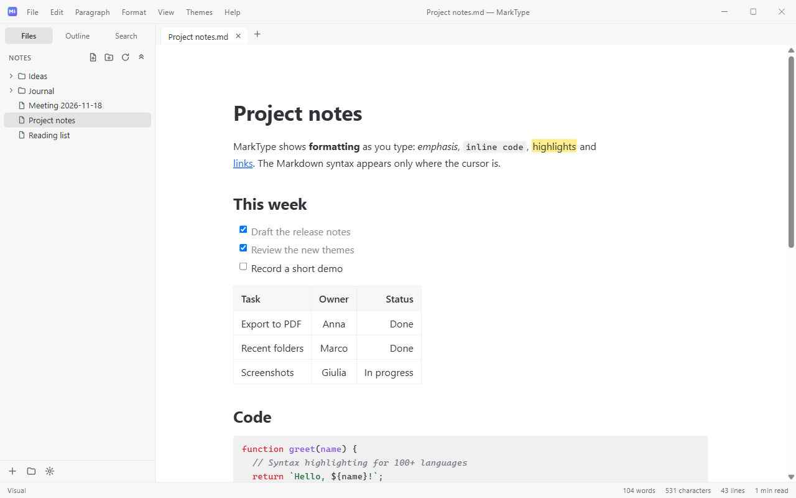
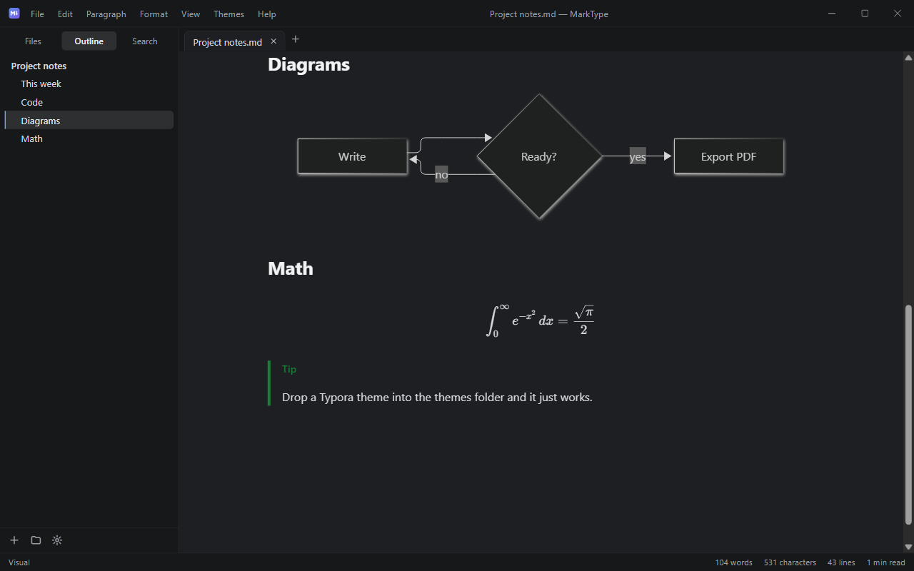
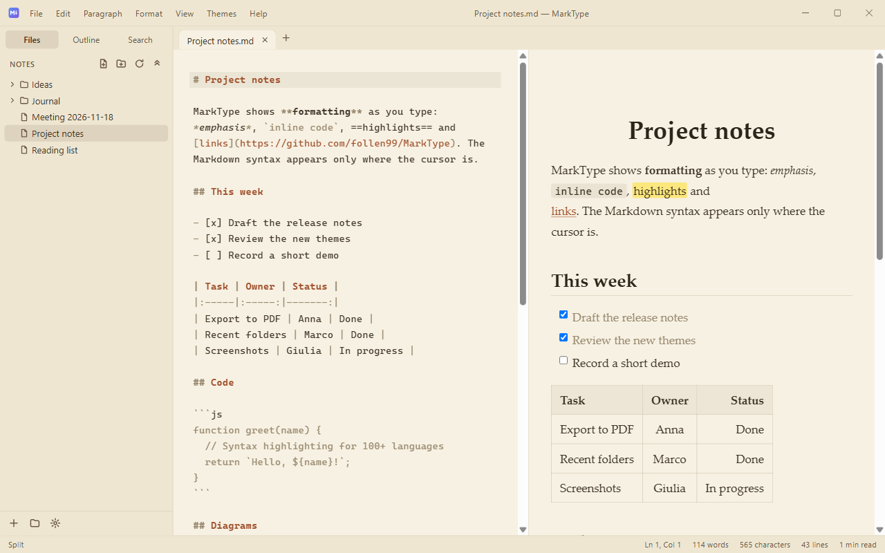

# MarkType

**A lightweight, Typora-style WYSIWYG Markdown editor for Windows, macOS and Linux.**
*Un editor Markdown WYSIWYG leggero, in stile Typora, per Windows, macOS e Linux.*

**Download:** [GitHub Releases](https://github.com/follen99/MarkType/releases/latest) · **Try it in the browser:**
[follen99.github.io/MarkType](https://follen99.github.io/MarkType/) · [Changelog](CHANGELOG.md)

<table>
<tr>
<td></td>
<td></td>
</tr>
<tr>
<td align="center">Dark theme, outline, diagrams and math</td>
<td align="center">Split view (source + preview), Paper theme</td>
</tr>
</table>

## Features

- **Seamless editing**: you write Markdown and see it rendered; the syntax shows up only where the cursor is.
  Source mode (`Ctrl+/`) and split view are also available.
- **Typora shortcuts**: `Ctrl+B`, `Ctrl+1…6`, `Ctrl+Shift+K` and the rest, customizable in `keybindings.json`
  ([list](docs/SHORTCUTS.md)).
- **Folders**: file tree, document outline (TOC), tabs, quick open (`Ctrl+P`), search in folder, file management,
  recent folders; the last folder and open files come back at the next start.
- **Typora-compatible themes**: drop a Typora `.css` theme into the themes folder and it works. Live reload and
  user CSS overrides ([docs/THEMES.md](docs/THEMES.md)).
- **Images**: paste with `Ctrl+V`, drag & drop or insert from a file; they are copied to `./assets`
  (configurable, or with `typora-copy-images-to`) and never overwrite an existing file. HTML pasted from web
  pages and Word becomes Markdown.
- **Rich rendering**: syntax highlighting, Mermaid, KaTeX math, GFM tables and task lists, footnotes, front
  matter, `[toc]`, GitHub alerts.
- **Export** to standalone HTML (theme included), PDF (on Windows straight to a file, optional header and
  footer), and with [Pandoc](https://pandoc.org) to Word, OpenDocument,
  RTF, EPUB and LaTeX.
- **Fits in the OS**: double click a `.md` file, "Open with MarkType" in Explorer, `marktype file.md` or
  `marktype ./folder` from a terminal; a second launch opens in the window already open.
- **Lightweight**: ~5 MB installer, built with [Tauri 2](https://tauri.app) and Rust.
- A **web version** on [GitHub Pages](https://follen99.github.io/MarkType/) (single file open/save, no folders).

## Installation

Download the installer for your system from the latest [release](https://github.com/follen99/MarkType/releases).

### Windows (10 and 11)

1. Download `MarkType_x.y.z_x64-setup.exe` (or the `.msi`, which installs for all users and needs administrator
   rights).
2. Run it. The builds are not code-signed yet, so SmartScreen may say "Windows protected your PC": click
   **More info → Run anyway**. The `.exe` installer does not need administrator rights (it installs in
   `%LOCALAPPDATA%\MarkType`).
3. `.md` files: right-click one → **Open with → Choose another app → MarkType**, tick "Always", to open them
   with a double click. Folders and Markdown files also get **Open with MarkType** in the context menu
   (Windows 11: under "Show more options").
4. WebView2 is part of Windows 10/11; if it is missing the installer downloads it.

### macOS (11 or later)

1. Download the `.dmg` (one universal build for Apple Silicon and Intel) and drag MarkType into Applications.
2. The first time, macOS blocks apps from unidentified developers: right-click MarkType → **Open** → **Open**,
   or run `xattr -dr com.apple.quarantine /Applications/MarkType.app` in Terminal.
3. To open `.md` files with a double click: select one in Finder → **Get Info** → "Open with: MarkType" →
   **Change All…**.

### Linux

- **AppImage**: `chmod +x MarkType_*.AppImage` and run it (needs `libwebkit2gtk-4.1`, `libfuse2` on some
  distributions).
- **Debian/Ubuntu**: `sudo apt install ./MarkType_*_amd64.deb`. **Fedora/openSUSE**: `sudo dnf install
  ./MarkType-*.x86_64.rpm`. These register MarkType for Markdown files and add `marktype` to the PATH.

### Settings and uninstalling

Settings live in `settings.json` and `keybindings.json` (File → Settings… → buttons at the bottom), in
`%APPDATA%\MarkType` (Windows), `~/Library/Application Support/MarkType` (macOS) or `~/.config/marktype`
(Linux), together with the `themes` folder. Uninstalling the app leaves that folder in place: delete it to
remove your settings too.

## Documentation

| Doc | Content |
|---|---|
| [SPEC.md](docs/SPEC.md) | Functional specification (Italian) |
| [ARCHITECTURE.md](docs/ARCHITECTURE.md) | Architecture and tech choices |
| [ROADMAP.md](docs/ROADMAP.md) | Milestones and progress |
| [SHORTCUTS.md](docs/SHORTCUTS.md) | Keyboard shortcuts and `keybindings.json` |
| [THEMES.md](docs/THEMES.md) | Theme format and Typora compatibility |
| [CONTRIBUTING.md](CONTRIBUTING.md) | Development setup |

## License

[GPL-3.0](LICENSE). The bundled *Formal Dark Pro* theme is MIT-licensed; see `packages/themes/builtin/formal-dark-pro/`.

MarkType is an independent project, not affiliated with Typora.
