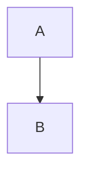

[toc]

A ==highlighted== phrase, <kbd>Ctrl</kbd>+<kbd>B</kbd>, H2O, x2 and <del>removed</del>.

Line one line two line three.

An unclosed <kbd> tag stays as source.

Emoji shortcodes stay as written: :smile: :tada:

Footnote[^note].

[^note]: The note text.
