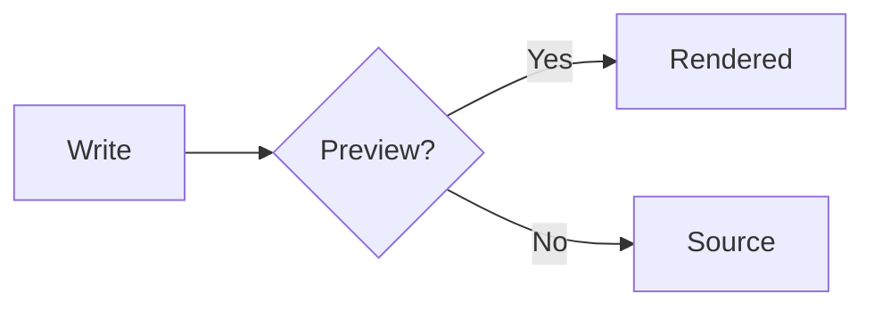

# MarkType showcase

[toc]

A file to try the editor. Click on **bold text**, *italic text*, `inline code`, ~~strikethrough~~,
<u>underline</u>, ==highlighted text== or a [link](https://github.com/follen99/MarkType "MarkType on GitHub")
and the markdown syntax appears around it. Ctrl+click opens the link.

Keys like <kbd>Ctrl</kbd>+<kbd>B</kbd>, H<sub>2</sub>O, E = mc<sup>2</sup> and emoji :tada: :rocket:.

## Headings

### Third level

#### Fourth level

##### Fifth level

###### Sixth level

## Lists

- Bullet item
- Another item
  - Nested item
- Last item

1. First
2. Second
3. Third

- [x] A completed task
- [ ] A task to do: click the checkbox

## Quotes and alerts

> Simplicity is prerequisite for reliability.
>
> > A nested quote.

> [!TIP]
> GitHub alerts are rendered and kept intact when you save.

> [!WARNING]
> Type `> [!NOTE]` and press Enter to create one.

## Code

```rust
fn main() {
    let greeting = "Hello from MarkType";
    println!("{greeting}"); // syntax highlighting
}
```

```python
def fib(n: int) -> int:
    return n if n < 2 else fib(n - 1) + fib(n - 2)
```

## Diagrams



## Math

Inline math $a^2 + b^2 = c^2$ and a block:

$$
\int_0^\infty e^{-x^2}\,dx = \frac{\sqrt{\pi}}{2}
$$

## Table

| Feature | Shortcut | Status |
| :------ | :------: | -----: |
| Bold    |  Ctrl+B  |   done |
| Heading |  Ctrl+1  |   done |
| Source  |  Ctrl+/  |   done |

Click in a cell to see the table toolbar; Ctrl+Enter adds a row.

---

## HTML and footnotes

<details>
  <summary>Click me</summary>
  Hidden content.
</details>

A sentence with a footnote[^1].

[^1]: The footnote text.
